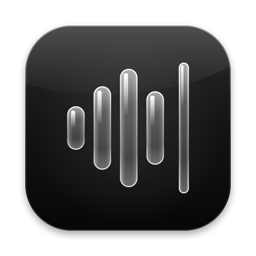
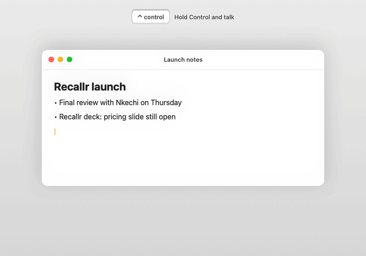

<p align="center">
  
</p>

<h1 align="center">Murmur</h1>

<p align="center">
  <b>Talk, and it types.</b> Private, on-device dictation for the Mac.<br>
  Free and open source. No account, no subscription, no cloud.
</p>

<p align="center">
  <a href="https://github.com/lhz56/murmur/actions/workflows/tests.yml"></a>
  <a href="LICENSE"></a>
  
  
</p>

<p align="center">
  
  <br><sub>Rendered from Murmur's real recording pill with <code>Tools/RenderDemo.sh</code>. The live preview hears "recaller"; the final text uses the spelling on screen.</sub>
</p>

---

Hold **Control** in any app, say what you mean, and let go. Murmur turns your voice into clean text where you were typing, a fraction of a second after you let go, without anything leaving your Mac.

It runs NVIDIA's Parakeet speech model on the Neural Engine, so it's fast and stays cool on a fanless or quiet Mac. It learns the names and words you use, from your screen, your project, and your own corrections, and it keeps a searchable library of everything you've said.

## Install

You need an **Apple silicon Mac on macOS 26** and Apple's Command Line Tools (`xcode-select --install`).

```sh
git clone https://github.com/lhz56/murmur.git && cd murmur && ./install.sh
```

`install.sh` builds the speech helper the first time, builds and signs Murmur locally, installs it in Applications, and opens it. A welcome guide walks you through the Microphone and Accessibility permissions and a first dictation. Run `./install.sh` again after `git pull` to update.

## Use

| Do this | Press |
|---|---|
| Dictate (hold, talk, release) | **Control** (or Right Option, Right Command, Fn, or a mouse button) |
| Hands-free start / finish | **⌃ ⌥ Space** |
| Cancel | **Esc** |
| Paste your last transcript again | **⌃ ⌥ V** |
| Type your last transcript (for apps that block paste) | **⌃ ⌥ T** |
| Rewrite selected text by voice ("make this shorter") | **⌃ ⌥ E** |

Short taps of Control are ignored, so your normal shortcuts keep working.

## What it does

**Fast, accurate, local**
- Parakeet TDT 0.6B on the Neural Engine, with Apple's on-device recognizer for live text while you speak. Whisper is optional.
- Murmur's own idle CPU use is close to zero: it waits for key events instead of polling the keyboard.

**Understands your words**
- **Context words:** names and unusual words on screen in the app you're dictating into, file and product names from the project you're working on, and optionally your Contacts. A small second model listens for them and swaps them in only when the audio supports it ("recaller" → **Recallr**).
- **Learns from your fixes:** correct a misheard word right after Murmur types it, or in the library, and it's remembered.
- **Vocabulary:** your own `heard => meant` corrections.

**Writes clean text**
- Removes "um" and "uh"; "scratch that" deletes the last sentence; "new line" and "new paragraph" work.
- "lin at gmail dot com" → lin@gmail.com; "one… two… three…" → a numbered list.
- Matches the app: no closing period in chats and terminals. Voice snippets: "insert my email."

**With Apple Intelligence** (optional, also on-device)
- "Tuesday, no wait, Wednesday" → "Wednesday."
- Edit selected text by voice, per-app writing styles ("In Mail, professional and concise"), and Ask questions about your notes.

**A library of everything you've said**
- Search by keywords or questions, favorites, editing, export, and Trash. Every transcript shows *what Murmur did*: the words it listened for, the cleanup steps, timings, and how the text was inserted.
- Insights: words per day, speaking pace, and time saved versus typing.
- Optional audio retention (7, 30, or 90 days) and storage controls.

**Thoughtful details**
- Lowers your music while you talk, can leave your clipboard untouched when it pastes, can start quietly at login, and follows light and dark mode.

## Privacy

Recording, recognition, cleanup, and the optional Apple Intelligence features all run on your Mac. Your library lives in `~/Library/Application Support/Murmur/`. Murmur connects to the internet only to download speech models on first use, and, if you turn it on, to check GitHub for a new release. There's no analytics. [SECURITY.md](SECURITY.md) lists exactly what Murmur reads and when.

## Build from source

```sh
./Tools/BuildLocalSpeech.sh --parakeet-only   # once: the Parakeet helper (omit the flag to also build Whisper)
./build.sh                                    # build and locally sign Murmur.app (quit Murmur first)
./test.sh                                     # run the test suites
```

There's no Xcode project; Murmur compiles straight from `Sources/` with `swiftc`. See [docs/ARCHITECTURE.md](docs/ARCHITECTURE.md) for how recording, insertion, storage, and recovery work, and [CONTRIBUTING.md](CONTRIBUTING.md) to get involved.

`Tools/Release.sh 1.1` packages a release zip. Builds are signed locally, not notarized, so on another Mac the first launch needs right-click → **Open**.

## Credits

Murmur stands on [FluidAudio](https://github.com/FluidInference/FluidAudio) (Apache 2.0) and NVIDIA's [Parakeet](https://huggingface.co/nvidia/parakeet-tdt-0.6b-v3) models (CC BY 4.0, Core ML conversions by FluidInference), with optional [whisper.cpp](https://github.com/ggml-org/whisper.cpp) and OpenAI Whisper (MIT). Full notices are in [Resources/THIRD-PARTY.txt](Resources/THIRD-PARTY.txt).

## License

[MIT](LICENSE) © 2026 Lin Zaw
