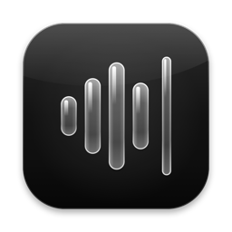
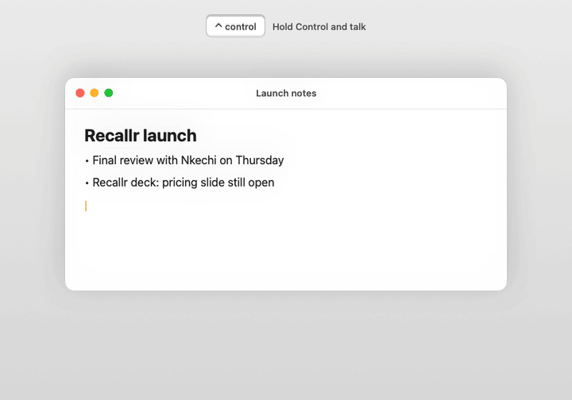

<p align="center">
  
</p>

<h1 align="center">Murmur</h1>

<p align="center">
  <b>Talk, and it types.</b> Private, on-device dictation, meeting notes and voice commands for the Mac.<br>
  Free and open source. No account, no subscription. Your voice never leaves your Mac.
</p>

<p align="center">
  <a href="https://github.com/lhz56/murmur/actions/workflows/tests.yml"></a>
  <a href="LICENSE"></a>
  
  
</p>

<p align="center">
  
</p>

---

Murmur lets you type with your voice, in any app on your Mac. Hold down the **Control** key, say what you want to write, and let go. Your words show up where you were typing, cleaned up and spelled right.

It's free, and dictation, meeting notes and Commands all happen on your own computer. The one exception is **Ask**, which you can turn off: when you ask a question about your screen, screenshots, transcribed words, selected text and window context go to your selected provider using its connected account.

## Why I built this

I love dictating instead of typing, but the good dictation apps, like Wispr Flow, cost a monthly subscription and send your voice to their servers. Macs today are fast enough to do all of that themselves, so I built Murmur: the same idea, free forever, open source, and private by design.

## What it does

**🎙️ Talk anywhere, it types for you.** Email, Slack, Notes, your code editor, a browser. If you can type there, you can talk there. You see your words appear while you speak.

**🔒 Private.** Your voice never leaves your Mac. No account, no sign-up, no internet needed once it's set up (except for Ask, below).

**👀 One key to ask or do.** Hold **Space + ↓** and talk. Say what to do (“open T3 Code, open the thread called launch notes and type ship it tonight”) and anything Murmur can do itself (opening apps, pressing a named button, tab or row through Accessibility, typing your exact words, music, timers) runs right away on your Mac, with no AI. Or ask “what does this error mean?”, “where is that setting?”, or “draft a reply saying I’ll look tomorrow.” Murmur sends a screenshot of the display under your pointer, your transcribed words, selected text, and front-app/window context to the provider you choose. The screenshot can include other visible windows. Your audio is recognized on your Mac. Answers stream into a bubble, point at relevant controls, and are spoken using local Kokoro speech or the Mac’s voice.

Ask can draft into the original text box, run a limited set of directly requested Commands, or press a button, switch, checkbox, tab, link or menu item that you name ("turn on Wi-Fi", "click Save"). It never clicks Send, Buy, Delete or anything like them, and anything it can't identify is left for you. Actions run only after a complete answer, one per observation. Escape cancels pending work; an action already dispatched to another app cannot be undone by cancellation. Walkthroughs move on when you click the control it pointed at, look again once the screen settles, and you can always just say "next". Optional follow-up listening opens the microphone briefly after speech finishes.

Ask uses your existing **ChatGPT** account through Codex or **Claude** account through Claude Code, subject to provider availability, plan limits and terms. Ask checks the account before sending a model request and refuses an API-key account. Configure the provider and model in Settings → Ask. This is a turn-based screenshot assistant, not a continuous screen stream or Realtime API connection.

**🧠 Knows your words.** Murmur notices the names and made-up words on your screen and in the project you're working on, and remembers the ones you keep running into. After a while it just knows them, even when they aren't on screen: say "recaller" and it writes **Recallr**. Ordinary words you say clearly are never swapped out. It can also learn names from your Contacts.

**✍️ Learns from your fixes.** If Murmur gets a word wrong and you fix it, it remembers for next time.

**🧹 Cleans up as you go.**
- Takes out "um" and "uh."
- Say "scratch that" to delete what you just said.
- Say "new line" or "new paragraph" to start one.
- "lin at gmail dot com" becomes lin@gmail.com, and "one… two… three…" becomes a numbered list.
- Fits the app: casual in chats, no stray periods in the terminal.

**⚡ Shortcuts for things you type a lot.** Say "insert my email" and it types your email address. You set these up yourself.

**✨ Extra smarts with Apple Intelligence** (optional, also on your Mac)
- Fixes your mid-sentence changes: "Tuesday, no wait, Wednesday" becomes "Wednesday."
- Rewrite selected text by voice: select a paragraph and say "make this shorter."
- Ask questions about everything you've dictated before.

**📝 Notes for every meeting.** When a call starts in Zoom, Google Meet, Teams, Slack, FaceTime, Discord or anywhere else, Murmur asks if you'd like notes. It listens to both sides (you through the microphone, everyone else through your Mac's sound), shows the words as people talk, and when the call ends the notes start appearing within seconds: a summary, the topics, decisions, and action items with who's doing what by when. Jot your own notes while you listen and Murmur builds on them; the agenda from your calendar invite helps too. During the call, ask "catch me up" or "what should I ask?"; afterwards, "what did I promise?" or "write a follow-up email." Long meetings are summarized as they go, so the notes don't take longer at the end. You get a notification when they're ready. No bot joins your call, and nothing leaves your Mac. Connect your calendar and meetings get their real names, and a minute before a call you get a "Join & take notes" button.

**⌘ Commands: just say what you want.** Press **Space + Down Arrow** together and type, or hold them and talk: "open Spotify and play Drake", "open murmur in Cursor", "play lofi on YouTube", "search Amazon for desk lamps", "timer 25 minutes", "volume 30", "lock screen", "take meeting notes". It opens apps, websites, files and folders, plays the actual song or video (not just a search page), runs your Shortcuts, and controls your Mac. Select a song name and say "play this." It can also type for you in other apps: "tell Claude to fix the login bug" or "open Slack and write on my way" puts your exact words in the message box, but never presses Send. Simple commands run the moment you let go. Murmur learns from you: pick a different result once and it comes first next time, and typing the start of something you've run before offers it again. **⌘1–⌘9** runs any row. It knows your own sites: "open WorkLoom" goes to your WorkLoom, found in your browser history and project folders, and if it isn't sure it asks once and remembers. Make your own: "work mode" can open everything you need at once.

**📚 Remembers everything you've said.** Every dictation is saved in a searchable library on your Mac, so you can find, copy, or fix anything later. You can also see how many words you've spoken and how much time you've saved compared to typing.

**🩺 Warns you before your Mac freezes.** When the disk fills up, macOS has nowhere to put extra memory and starts freezing apps. Murmur watches free disk, swap and memory pressure, tells you what's using the most memory before it happens, and can clear developer caches with one click.

**🎧 Small touches.** It turns your music down while you talk, can start when your Mac starts, and works in light and dark mode.

## Install

You need a Mac with Apple silicon (M1 or newer) running macOS 26. Open the Terminal app and paste:

```sh
xcode-select --install
git clone https://github.com/lhz56/murmur.git && cd murmur && ./install.sh
```

The first line installs Apple's free developer tools (skip it if you already have them). The second downloads Murmur, builds it, and puts it in your Applications folder. A short welcome guide then walks you through the two permissions it needs (microphone and Accessibility, so it can type for you), downloads the free models with one click, and has you try dictation and Commands. To update later, run `git pull && ./install.sh` in the same folder.

## How to use it

| To do this | Press |
|---|---|
| Talk and type (hold, talk, let go) | **Control** (you can pick a different key or a mouse button) |
| Talk without holding a key | **⌃ ⌥ Space** to start, again to finish |
| Cancel | **Esc** |
| Paste what you last said again | **⌃ ⌥ V** |
| Type what you last said (for apps that block pasting) | **⌃ ⌥ T** |
| Rewrite selected text by voice | **⌃ ⌥ E** |
| Ask or do anything: hold and talk (a quick tap opens the palette to type) | **Space + ↓** |
| Meeting notes | Click **Take notes** when Murmur spots a call, or **Start taking notes** on the Meetings page |

A quick tap of Control does nothing, so your usual keyboard shortcuts still work.

## Meeting notes use a free AI model on your Mac

The best notes come from [Ollama](https://ollama.com), a free app that runs AI models on your Mac. Install it, run `ollama pull qwen3:8b` once, and Murmur uses it automatically (on Macs with 32 GB or more it prefers bigger models when you have them). Without Ollama, Murmur uses Apple Intelligence if it's on, and otherwise writes simpler notes on its own. It never uses a paid service.

For Commands, a tiny model is enough: `ollama pull qwen3:1.7b` (1.4 GB) lets Murmur understand loose requests like "put on something chill" in about a fifth of a second. Murmur loads models only when needed and lets them go within a minute, so they don't sit in memory or warm up your Mac.

## Privacy

Dictation and meeting audio are processed on your Mac, and their libraries live in `~/Library/Application Support/Murmur/`. **Ask is the cloud exception:** screenshots, selected text, window context and transcribed questions go to the selected provider. Follow-ups and walkthroughs send additional observations and retain provider conversation context. Temporary screenshots are removed after normal completion or cancellation; a crash may leave a temporary file. The last 40 Ask questions and answers are stored in app preferences and can be cleared in Ask. Murmur also goes online for model downloads, optional update checks and requested media searches. Provider retention and account policies apply to material sent through Ask. [SECURITY.md](SECURITY.md) describes these data flows.

## For developers

Murmur runs NVIDIA's Parakeet speech model on the Mac's Neural Engine, so it's fast and stays cool, with Apple's built-in recognizer for the live preview. A second small model listens for your on-screen words and swaps them in only when the audio supports it.

### Build from source

```sh
./Tools/BuildLocalSpeech.sh --parakeet-only   # once: the Parakeet helper (omit the flag to also build Whisper)
./build.sh                                    # build and locally sign Murmur.app (quit Murmur first)
./test.sh                                     # run the test suites
```

There's no Xcode project; Murmur compiles straight from `Sources/` with `swiftc`. See [docs/ARCHITECTURE.md](docs/ARCHITECTURE.md) for how recording, insertion, storage, and recovery work, and [CONTRIBUTING.md](CONTRIBUTING.md) to get involved.

`Tools/Release.sh 1.1` packages a release zip signed with Developer ID and notarized by Apple, so it opens with a double-click on any Mac (`Tools/Release.sh --check` checks the certificate and notary profile first). Builds from source sign with a private local identity unless the checkout has been switched with `Tools/SignApp.sh --use-developer-id`.

## Credits

Murmur stands on [FluidAudio](https://github.com/FluidInference/FluidAudio) (Apache 2.0) and NVIDIA's [Parakeet](https://huggingface.co/nvidia/parakeet-tdt-0.6b-v3) models (CC BY 4.0, Core ML conversions by FluidInference), with optional [whisper.cpp](https://github.com/ggml-org/whisper.cpp) and OpenAI Whisper (MIT). Full notices are in [Resources/THIRD-PARTY.txt](Resources/THIRD-PARTY.txt).

## License

[MIT](LICENSE) © 2026 Lin Zaw
